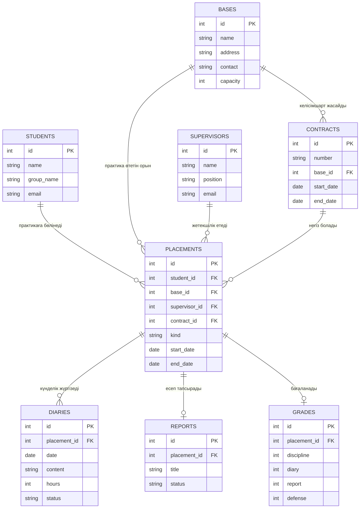

# Практиканы басқару жүйесінің ER схемасы

Негізгі байланыстар `schema.sql` ішінде сыртқы кілттермен бекітілген. SQLModel-дегі `Relationship` объектілері Python кодында осы байланыстар бойынша өтуге мүмкіндік береді.
